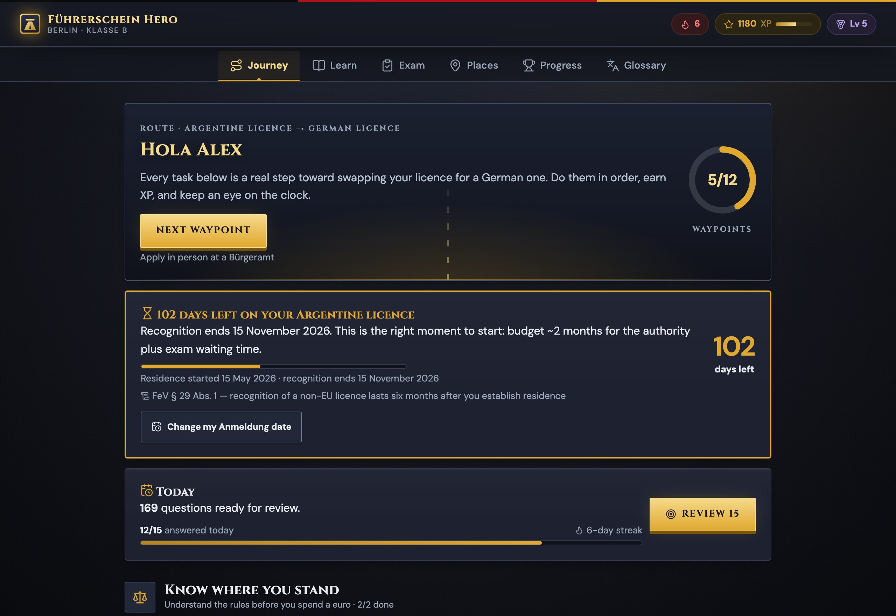
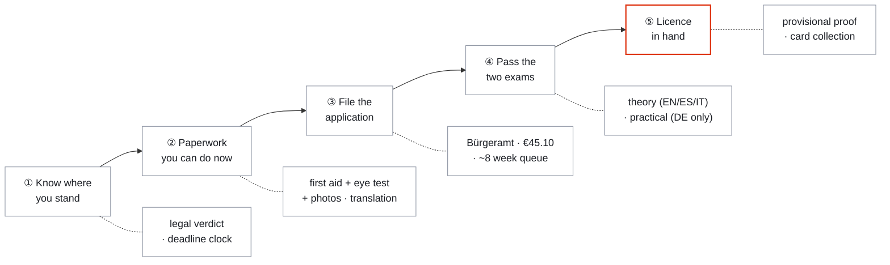
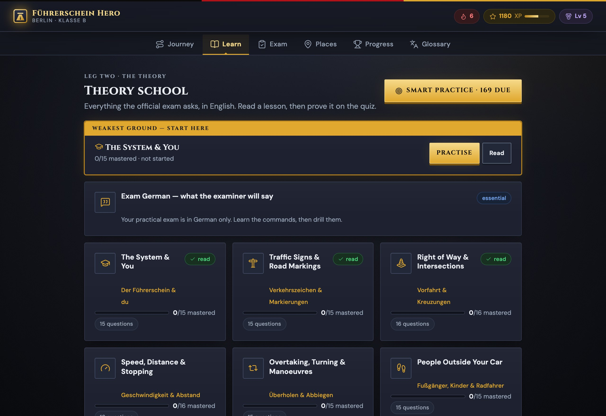
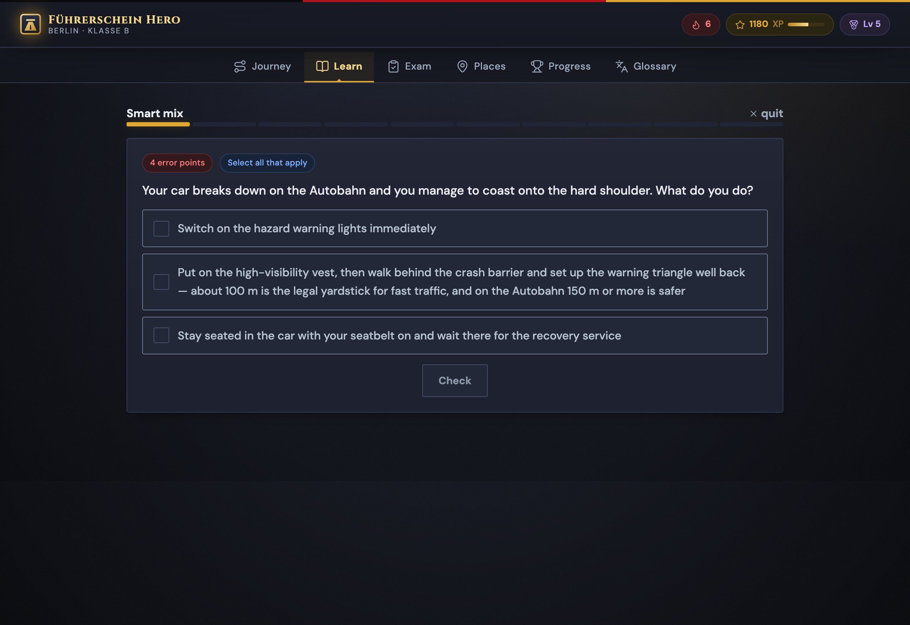
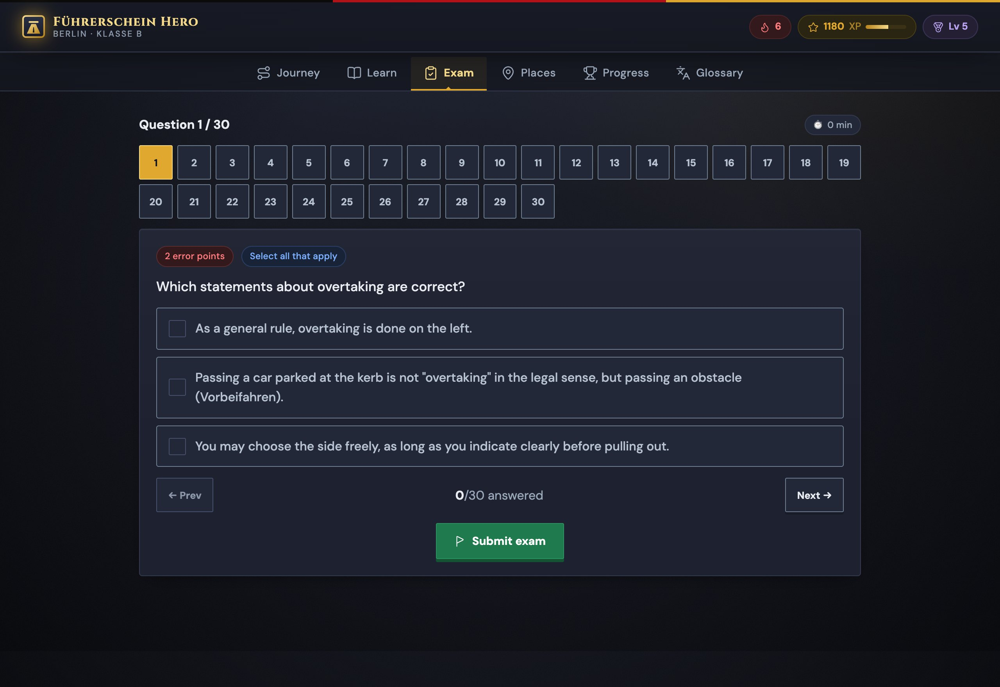
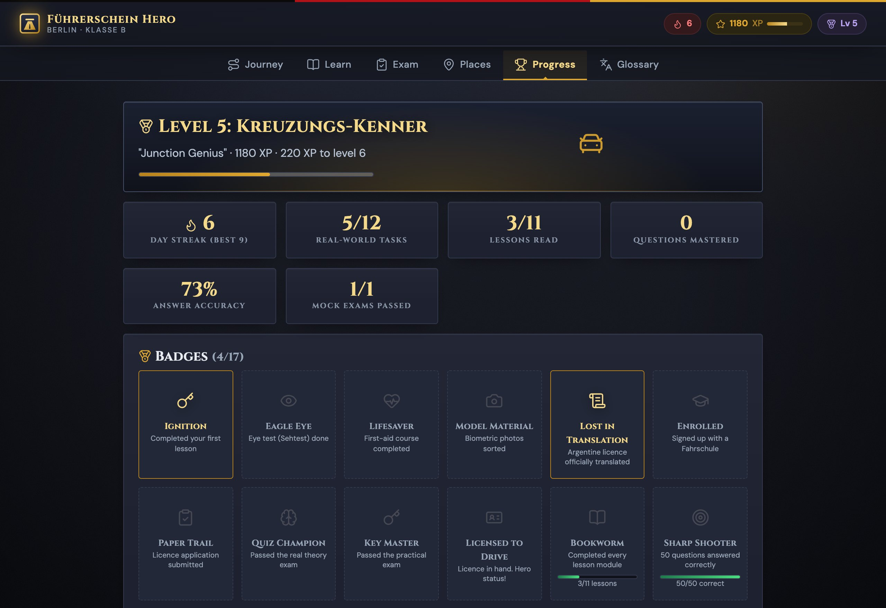
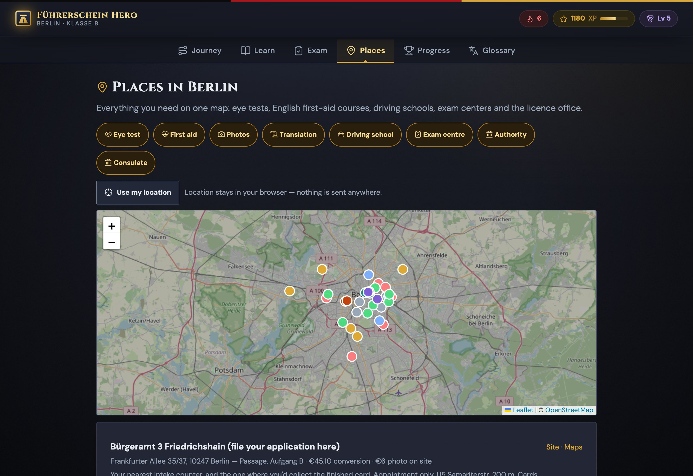
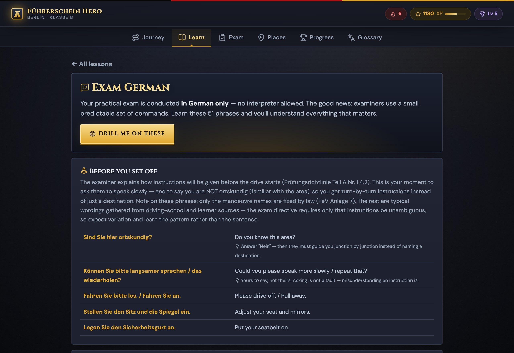
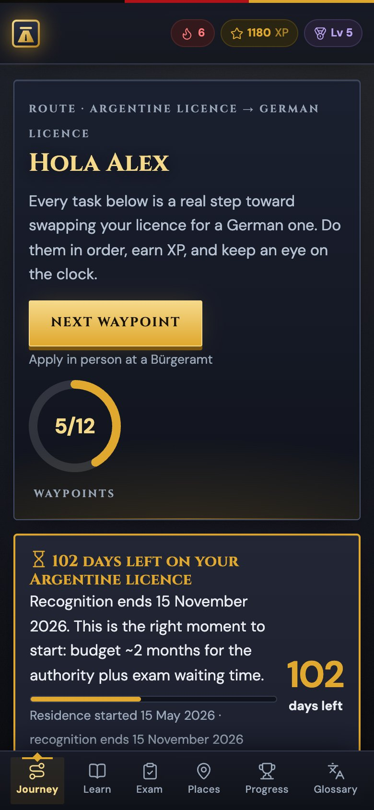

<div align="center">


# 🚦 Führerschein Hero

### Get a German driving licence in Berlin. In English. Without guessing.

**A gamified, offline-capable study and logistics companion for converting a foreign driving licence
in Germany.** It walks the full *Umschreibung* step by step and teaches the German class B theory
exam (*Klasse B*) in English, grounded in Berlin where the appointments actually happen.
No build step. No backend. No accounts. No tracking unless you opt in. Every legal claim sourced.

<br>

     
<br>
 

<br>

**[Quick start](#-quick-start) · [Features](#-whats-inside) · [Accuracy](#-accuracy-the-part-that-actually-matters) · [Security](#-security--privacy) · [Testing](#-testing) · [Architecture](#architecture) · [Deployment](#-deployment) · [Contributing](#-contributing) · [Support](#-support-this-project)**

<br>



</div>

---

## 🧭 What this is

Moving to Germany with a non-EU driving licence starts a clock most people don't know is running.
Under **§ 29 Abs. 1 Satz 4 FeV** a foreign licence is recognised for **six months** after you
establish ordinary residence. After that, driving on it is *Fahren ohne Fahrerlaubnis*, a criminal
offence under **§ 21 StVG**.

The conversion itself involves a first-aid course, an eye test, a certified translation, a driving
school, a *Prüfauftrag*, two exams, and an authority queue measured in weeks, almost all of it
described only in German across a dozen unconnected websites. **Führerschein Hero collapses that
into one guided route**: what to do next, why it is legally required, where to go in Berlin, how
long you have left, and a full theory course in English.

> [!IMPORTANT]
> This is a **study and planning aid, not legal advice**. Fees, waiting times and provider prices
> change. Always confirm your own case with LABO Berlin before spending money. See the
> [legal disclaimer](#legal-disclaimer).

| You hold… | What the app does | Route |
|---|---|---|
| 🌍 **A non-EU licence** (Argentina is the worked example) | Tracks the six-month recognition deadline, walks the full *Umschreibung* under **§ 31 FeV**, and trains you for **both** mandatory exams | **5 phases, 12 tasks** |
| 🇪🇺 **An EU/EEA licence** | Explains why it stays valid with no exam, and the narrow cases where exchange becomes mandatory | 1 phase, 1 task |
| 🚫 **No licence at all** | Points at the *Ersterteilung* route from scratch, which shares the same exam machinery | 1 phase, 1 task |

The non-EU route is the one built out in depth. The other two are honest signposts, see
[non-goals](#-non-goals--roadmap).

## ⚡ Quick start

There is **no build step and nothing to install**. It is hand-written ES modules and CSS, so you
serve `src/` with any static file server and open it.

```bash
git clone git@github.com:agusgonzaleznic/drive-berlin.git
cd drive-berlin
npm run dev            # python3 -m http.server 4173 -d src
# → open http://localhost:4173
```

`npm install` only fetches `playwright-core` for the browser tests. Other servers work too
(`npm run dev:node`, `npx http-server src -p 4173`, `php -S localhost:4173 -t src`), and so does any
static host, see [deployment](#-deployment). Serve over `http(s)://`, not `file://`, which blocks ES
modules and `fetch()` of the JSON data files.

**Offline:** almost entirely. All content, logic, icons, road-sign artwork, fonts and the Leaflet 1.9.4
build are local, so neither a CDN nor Google Fonts is contacted. Exactly **one** thing reaches the
network: map tiles from `tile.openstreetmap.org`. If blocked, the map area shows a fallback and the
place list, addresses and links still work. A missing font falls back to a local stack, and a missing
Leaflet global makes `renderMap()` render the list-only view. No content, progress or personal data
is ever fetched or sent.

## 📦 What's inside

<div align="center">

| | | |
|:--:|:--:|:--:|
| **169**<br>exam-style questions | **11**<br>theory modules | **12**<br>real-world tasks |
| **64**<br>glossary terms | **51**<br>examiner phrases | **35**<br>Berlin locations |
| **36**<br>road-sign SVGs | **17**<br>badges, **10** levels | **~59.5k**<br>words of sourced research |

</div>

### 🗺️ The journey: logistics, not just study

The conversion route is modelled as five phases you walk in order. Each task carries the statutory
basis, the real cost, what to physically bring, and where to go.



**The deadline clock is the feature that justifies the app.** Given an *Anmeldung* date it computes
the recognition end date from `src/data/rules.json` and escalates as it closes: 🟢 `plan` at 150 days
or fewer, 🟡 `urgent` at 90 or fewer (the authority alone takes about 8 weeks) and 🔴 `critical` at 30
or fewer.

> [!NOTE]
> **`licenceClock()` returns `null` rather than guessing.** If the app cannot source a recognition
> period for your licence country, it says so and shows nothing. See
> [accuracy](#-accuracy-the-part-that-actually-matters).

### 🎓 Theory course, practice and mock exam

Eleven English modules (`m01-system` to `m11-berlin`, each 12 to 20 questions), each ending in a quiz
drawn from the same pool as the mock exam. **Spaced repetition** uses Leitner boxes 0 to 4, reviewed
after the same day, +1, +3, +7 and +16 days. A right answer promotes a question and a wrong one resets
it to box 0. A session reserves **30 %** of its slots (`FRESH_RATIO`) for never-seen questions, so a
review backlog can never starve new coverage. The daily goal is **15** answers.

<div align="center">
 
</div>

**The mock exam implements the *real* rules.** Most free trainers just count a percentage. This one
reproduces the official class B format:

| Rule | Implementation |
|---|---|
| Question count | **30**, being 20 *Grundstoff* plus 10 *Zusatzstoff* |
| Scoring | **Error points** weighted 2 / 3 / 4 / 5 per question, not a percentage |
| Pass threshold | **10 error points or fewer** |
| ⚠️ Automatic fail | **Two wrong 5-point questions means failed**, even at 10 points or fewer |
| Multi-answer | A partially correct multi-answer question scores **zero**. All or nothing |

That automatic-fail rule is the single most commonly missed fact about the German theory exam.
`scoreExam()` enforces it, and `tests/scoring.test.mjs` asserts it in both directions.

**Readiness is deliberately hard to satisfy.** `examReadiness()` weights question-pool mastery
**0.45**, mock-exam performance **0.40** and lessons completed **0.15**. It then refuses to report "ready" without
at least **two passes in your last three attempts**, however high the arithmetic gets.

<div align="center">
 
</div>

### 🗣️ Examiner German, 📍 Berlin places and 🏆 gamification

- **Examiner German.** The theory exam can be taken in **12 languages** (*Anlage 7 Nr. 1.3 FeV*, with
  English, Spanish and Italian among them). **The practical cannot**: it is German only, with no
  interpreter, so the app drills the roughly 50 phrases an examiner says, grouped by manoeuvre.
- **Berlin places.** 35 verified locations on a Leaflet map with an accessible list fallback: free eye
  tests, English first-aid courses, photo booths, *Bürgerämter*, DEKRA and TÜV *Prüfstellen*, and
  driving schools. **Geolocation is opt-in, used only to sort the list locally, and never stored or
  transmitted.** The default view is central Berlin.
- **Gamification.** XP for every lesson, correct answer, task and exam across **10** levels with
  German driver titles, from *Fußgänger* (Pedestrian, 0 XP) to *Führerschein-Held* (Licence Hero,
  5000 XP), plus **17 badges**, all reachable, which a test asserts. Day streaks **decay honestly**
  when you lapse instead of silently freezing, and all animation respects `prefers-reduced-motion`.

<div align="center">
 
<br>
<br><sub>Responsive down to 390 px, measured rather than assumed</sub>
</div>

## 🎯 Accuracy: the part that actually matters

A study app that invents a legal deadline is worse than no app. The governing constraint of this
project was simple: **assume freely about implementation, never about content.**

Research ran under a strict source precedence: ① primary law (gesetze-im-internet.de: FeV, StVG,
StVO, GebOSt and annexes), ② official Berlin sources (service.berlin.de, LABO trackers), ③ examiners
and ADAC (DEKRA, TÜV), ④ commercial or journalistic sources, treated as weak evidence and flagged
inline. Statutory claims had to quote the German text verbatim. Each research domain then went to a
**separate verifier that had not seen the research and was instructed to refute rather than
confirm**, returning to the primary source and recording a per-claim verdict. Where the verifier
corrected the researcher, the correction won. That is what caught the errors that mattered:

| Claim that didn't survive | Reality |
|---|---|
| "You must convert within three years" | **No such rule exists** anywhere in FeV §§ 28–31 or Anlage 11. It is a widely repeated phantom deadline |
| The *Prüfbescheinigung* lets you drive | **Dangerous misreading.** It does not |
| EU Directive 2025/2205 "changes nothing until 2029" | **Staggered** across 2027, 2028 and 2029 (Art. 29) |
| Convert in Italy instead | Barred by **§ 28 Abs. 4 Satz 1 Nr. 8 FeV** |

**The honesty rules, enforced in code:**

- **Legal periods live in [`src/data/rules.json`](src/data/rules.json)** and are never hardcoded in
  logic. If a period is absent, the UI shows nothing rather than a plausible number.
- Claims that could not be confirmed against a primary source are marked **⚠️ unverified** at the
  point of use rather than quietly dropped.
- **Not every verification pass completed.** Three research files have no verifier counterpart, and
  the documents say so explicitly.
- `tests/data.test.mjs` asserts data integrity: every question has exactly one correct-answer set,
  every task references a real phase, and every badge is reachable.

The methodology, and which claims a verifier confirmed, corrected or could not resolve, are recorded
in **[`docs/knowledge-base/`](docs/knowledge-base/)** (8 documents, ~59.5k words, with a
[README](docs/knowledge-base/README.md) on scenario, methodology, coverage gaps and caveats). The
agents' raw JSON output is kept locally rather than committed, so the documents cite those filenames
as provenance labels.

## 🔒 Security & privacy

There is no backend, no account and no error reporting. Google Analytics loads only if you allow it
on the banner: until then nothing is sent to Google and no cookie is set. All of the app's state lives
in `localStorage`. That removes most of the usual attack surface, though not all of it, because the
app has an import button and builds every view from template literals.

Every finding below was reproduced before it was fixed, and each fix but the referrer policy is pinned
by an assertion in `tests/security.test.mjs`. To report something new, follow the
**[shared security policy](https://github.com/agusgonzaleznic/.github/blob/main/SECURITY.md)** (a
private report in the Security tab), and read **[`docs/security-posture.md`](docs/security-posture.md)**
first: it sets out what is in scope, what is not, and what the app already covers.

| Finding | Severity | Fix |
|---|---|---|
| **Prototype pollution** via progress import (`Object.assign(state, JSON.parse(json))` let `__proto__` through, verified empirically) | High | `sanitizeState()` allowlist that never copies `__proto__`, `constructor` or `prototype` |
| **Type confusion** via import: `badges: "ignition"` made `.includes()` match substrings, and `exams: {}` threw mid-render, blanking the screen | High | Per-key coercion, clamped counts, capped collection and string sizes |
| **`javascript:` URLs** in data-driven `href`s, which `esc()` does not neutralise | Medium | `safeUrl()` scheme allowlist, stripping control characters first so `java\nscript:` cannot slip past |
| **Partial escaping** in `icon()`, `emblem()`, `flag()` and `glyph()` | Medium | Full `&<>"'` escaping in all four |
| **No CSP** | Medium | Strict policy, with *zero* inline `<script>`. Google's tag host is the only external `script-src` origin, loaded only after you opt in to analytics |
| **Leaflet from `unpkg.com`**: SRI pinned the bytes but could not remove the CDN dependency | Medium | Leaflet 1.9.4 vendored into `src/assets/vendor/leaflet/`, byte-verified against the former `sha384` hashes |
| **Google Fonts disclosed every visitor's IP address** before a glyph was drawn, held unlawful without consent by LG München I (3 O 17493/20, January 2022) | Medium | Cinzel and DM Sans vendored into `src/assets/fonts/` as woff2 subsets, so `font-src` is `'self'` |
| **Referrer leakage** to authority sites | Low | `no-referrer` document-wide, plus `rel="noopener noreferrer"` on every external link |

The full policy is quoted in [`docs/security-posture.md`](docs/security-posture.md#what-the-app-already-does).
`style-src` keeps `'unsafe-inline'` because the views set `style=""` on 127 elements, and style
injection is far lower severity than script injection. The only external origins in the policy are the
map tile hosts and Google's analytics hosts, and the app contacts Google's only after you allow
analytics.

Two layers of test verify this. `tests/csp.mjs` drives real Chrome with no opt-in: **0 CSP
violations**, Leaflet initialises, tiles fetch, both font families load from this origin, and the
only third-party origin contacted is `tile.openstreetmap.org`. `tests/consent.browser.mjs` proves
that nothing is requested from Google before a choice, after a decline or after Escape. Because those
suites need system Chrome and cannot run in CI, `tests/security.test.mjs` re-asserts the policy by
reading the files, so a re-introduced CDN fails a pull request.

**Two caveats.** The review had one pair of eyes: the five adversarial agent lenses intended for it
failed twice on API capacity errors, so it was a mechanical sweep of all 475 template interpolations
reaching `innerHTML` plus a manual review of the import path, the network surface and the third-party
dependency. And **your exported progress file contains what you typed** (name, *Anmeldung* date,
licence country), the same data that sits in `localStorage`, so anyone with the browser profile can
read it. That is inherent to a local-first design.

## 🧪 Testing

Engine functions carry a `CONTRACT` JSDoc block stating what callers may rely on, and the test files
are written as the **specification** for those contracts. `tests/security.test.mjs` maps assertion by
assertion to the contract in `src/js/security.js`.

| Suite | What it covers | Result |
|---|---|:--:|
| `npm test` | Exam scoring, deadline maths, progress engine, data integrity, security primitives, first-party loading surface | **82 passed** |
| `test:browser` | All routes in real Chrome, a full mock exam, failing on any console error | **34 checks, 0 errors** |
| `test:course` | End-to-end walkthrough of the entire course | **~480 checks** |
| `test:a11y` | Keyboard navigation and `prefers-reduced-motion` | **8 passed** |
| `test:contrast` | Measured WCAG 1.4.3 ratios and touch-target sizes on every screen | all text passes |
| `test:csp` | CSP violations, vendored Leaflet and fonts, tile loading, third-party origins | **0 violations** |
| `test:consent` | The analytics banner: nothing requested from Google before a choice, after a decline or after Escape, plus focus, contrast and motion | **69 checks** |
| `emojiscan` | Asserts no emoji leaked back into the rendered UI | clean |

```bash
npm test              # unit, no browser needed
npm run test:all      # everything but test:contrast, including the full course walkthrough
```

The course-walkthrough total moves by a few checks between runs, because the mock exam composes a
fresh 30-question paper each time. Any non-zero `failed` count is a real failure. Browser suites drive
**system Chrome via `playwright-core`**, so there is no 300 MB browser download, and they disable the
HTTP cache over CDP, because stale ES modules once made a fixed bug look unfixed. More in
[`docs/development.md`](docs/development.md).

**Bugs these tests exist because of**, each shipped once and now pinned by an assertion: `toISOString()`
reads as the previous UTC day west of Greenwich, so a streak could break at 01:00 local time (fixed
with a local `isoDay()`); the exam navigator applied `current` XOR `answered`; a long `nowrap` pill
caused 18 px of horizontal overflow at 390 px; opacity-based `:disabled` styling measured 2.78:1,
below AA. Three times the *test* was wrong rather than the code, so verify which side is wrong before
"fixing".

<a id="architecture"></a>

## 🏗️ Architecture

Deliberately boring: no framework, no build, no state library. The whole app is **3,426 lines of JS
across 25 modules**, **949 lines of CSS** and a **119-line** HTML shell.

The flow: `index.html` (CSP, shell) → `app.js` (hash router) → 11 views (journey, learn, quiz, exam,
task, stats, map, glossary, phrases, onboarding, privacy). Views use `engine/` (scoring, deadline,
progress), `state.js` (XP, levels, badges, streak, which calls `security.js`: `sanitizeState`,
`safeUrl`) and `ui.js`, `icons.js`, `brand.js`, `signs.js`, `map.js`. `app.js` and the views load
`src/data/*.json` through `data.js` and pass the data to the engine.

**The stack:** hand-written HTML, plain CSS custom properties (a token-driven dark theme), vanilla ES
modules that run unbuilt in every modern browser, and one `localStorage` key for state. Icons are 84
vendored [Lucide](https://lucide.dev) SVGs and the 36 road signs are hand-drawn inline SVGs in real
German sign colours, never tokenised. Cinzel and DM Sans are vendored woff2, with the display face
restricted to headings because German compounds wrap badly. Tests are `node --test` and
`playwright-core`, one dev dependency in total.

**Accessibility is measured, not claimed.** Contrast ratios and touch-target sizes are computed in a
real browser on every screen. A dedicated `--line-control` token exists solely so that focusable
control borders clear 3:1 (WCAG 1.4.11).

## 🚀 Deployment

The static files are safe to serve as-is. Two protections can only come from response headers:

```
Content-Security-Policy: frame-ancestors 'none'
X-Frame-Options: DENY
X-Content-Type-Options: nosniff
```

A `<meta>` tag cannot set `frame-ancestors` by design, which is why it isn't in the document CSP.
**Serve over HTTPS** so that the CSP cannot be stripped in transit.

| Host | Headers? | Notes |
|---|:--:|---|
| **Cloudflare Pages** | ✅ | `_headers` file. Recommended |
| **Netlify** | ✅ | `_headers` or `netlify.toml` |
| **Vercel** | ✅ | `vercel.json` → `headers` |
| **Nginx / Caddy** | ✅ | `add_header` / `header` |
| **GitHub Pages** | ❌ | Cannot set custom headers, so `frame-ancestors` and `X-Frame-Options` are unavailable |

The publish root is **`src/`**. `npm run build` exists only to say there is nothing to build.

## 🧱 Non-goals & roadmap

**Deliberately not doing:** a backend, accounts or cloud sync (local-first is the privacy guarantee,
not a limitation); an official question catalogue (the real one is licensed, so these are original
questions in the same format and difficulty); a German UI (the point is English-language access);
`localStorage` encryption (it would need a passphrase, against a threat that already implies control
of the browser profile).

**Known gaps, stated honestly:**

- EU and first-licence routes are signposts, not full guides. Non-EU conversion is the built-out route.
- 3 research files have no independent verifier pass, marked ⚠️ unverified at each point of use, and
  the security review had a single pair of eyes (see [security & privacy](#-security--privacy)).
- Bottom tab targets are 40×49 px: they clear WCAG 2.5.8 (24 px) but not the 44 px comfort guideline.
- Light theme: 14 hardcoded values block a clean token flip, and sign colours must never be tokenised.

## 🤝 Contributing

Contributions are welcome, and the bar for factual changes is deliberately high: every legal fact,
fee or deadline needs a primary source. Start with **[`docs/development.md`](docs/development.md)**.
The general rules are in the shared
[contributing guide](https://github.com/agusgonzaleznic/.github/blob/main/CONTRIBUTING.md), and
participation is governed by the shared
[Code of Conduct](https://github.com/agusgonzaleznic/.github/blob/main/CODE_OF_CONDUCT.md). Open
issues through the [issue chooser](https://github.com/agusgonzaleznic/drive-berlin/issues/new/choose).
Hard non-goals: no backend, no accounts and no build step, and a proposal that needs any of the three
is declined regardless of merit. Reporting a bug? Include your browser and operating system, whether
it still happens after clearing `localStorage`, and any console errors.

---

## 💛 Support this project

It is free, it stays free, and there is nothing to upsell: no ads, no accounts, and no tracking
unless you opt in. I built it because I needed it, and the research underneath took considerably
longer than the code did. Three things help, in ascending order of effort:

- **Star the repo.** It is the only signal that tells the next person in this situation that any of
  this exists.
- **Open an issue when a number is wrong.** Fees, waiting times and provider prices drift constantly.
  A corrected figure *with its primary source* is the most useful contribution anyone can make here.
  Use the **Incorrect information** form in the
  [issue chooser](https://github.com/agusgonzaleznic/drive-berlin/issues/new/choose).
- **Drop a coffee on Ko-fi, or sponsor on GitHub**, if this saved you a wasted trip to LABO. Ko-fi
  is a one-off, and GitHub Sponsors can be monthly or one-time, with a custom amount. Re-verifying
  legal claims against primary sources is the slow, recurring, unglamorous part of keeping a project
  like this honest.

<div align="center">
<br>

[](https://ko-fi.com/agusgonzaleznic)
[](https://github.com/sponsors/agusgonzaleznic)
<br>
[](https://agusgonzaleznic.com)
[](https://github.com/agusgonzaleznic)
[](https://www.linkedin.com/in/agusgonzaleznic)

<br>

<sub>Built in Berlin by <b>Agustin Gonzalez Nicolini</b>. I work on engineering leadership and write
about it at <a href="https://agusgonzaleznic.com">agusgonzaleznic.com</a>.</sub>

</div>

---

<a id="legal-disclaimer"></a>

## ⚖️ Legal disclaimer

**This is not legal advice.** It is a study and planning aid assembled from public sources for one
documented scenario: a non-EU (Argentine) licence holder resident in Berlin. Fees, waiting times,
provider prices and authority backlogs **change constantly**, so read every euro figure and
processing time as *check before you go*. The reform expected around early 2027 was still a **draft**
when this was written, so do not plan around it. **Only LABO Berlin**, the *Fahrerlaubnisbehörde* of
the Landesamt für Bürger- und Ordnungsangelegenheiten, can tell you how your specific document will
be treated: confirm your own case before spending money or making irreversible decisions. Statutory
references were read on the dates stamped in each document, so re-check the linked primary source.

---

## 📄 Licence & attribution

**Open source, and attribution is required.** Because this repo is mostly prose wrapped around some
code, each part is licensed with the tool that fits it:

| Part | Paths | Licence |
|---|---|---|
| **Software** | `src/index.html` · `src/favicon.svg` · `src/css/**` · `src/js/**` · `scripts/**` · `tests/**` | [MIT](LICENSE) |
| **Content**, meaning the research, lessons, questions, glossary, phrases and locations | `docs/**` · `src/data/**` | [CC BY 4.0](LICENSE-CONTENT) |

You can use, modify and sell derivatives of both, commercial use included. **You must credit me.**
MIT requires the copyright notice to travel with the code. CC BY 4.0 §3(a) additionally requires
that you name the creator, link the licence, and **state whether you changed anything**.

Reusing the content? This satisfies it:

```
Content adapted from "Führerschein Hero" by Agustin Gonzalez Nicolini
(https://github.com/agusgonzaleznic/drive-berlin),
licensed under CC BY 4.0 (https://creativecommons.org/licenses/by/4.0/).
Changes were made.
```

> [!CAUTION]
> If you republish the content, **re-verify it against the primary sources first.** Every legal and
> commercial figure was accurate only on the date stamped in its document, and both licences
> disclaim all warranties. Shipping a stale deadline to someone who then loses the right to drive is
> the failure mode this project was built to avoid.

See [`NOTICE`](NOTICE) for the authoritative per-path breakdown.

### Contributing under these licences

Which licence applies to your contribution depends entirely on **which paths you touch**, as the
table above shows. **By opening a pull request you agree that your contribution is licensed under the
licence that covers the paths you changed**, on the same terms as the rest of the repository, and that
you have the right to contribute it. A pull request that touches both areas is licensed accordingly in
each. If you are copying text in from somewhere else, say so and name its licence. Quoting German
statutory text verbatim is safe (see below), but commercial driving-school prose is not.

### Third-party material

The following is not covered by either licence above. It keeps its own terms, and nothing here
relicenses it:

| Asset | Licence |
|---|---|
| [Lucide](https://lucide.dev) icons (84 vendored SVGs) | ISC, see [`src/assets/icons/LICENSE.lucide`](src/assets/icons/LICENSE.lucide) |
| [Cinzel](https://fonts.google.com/specimen/Cinzel), [DM Sans](https://fonts.google.com/specimen/DM+Sans), vendored woff2 | SIL Open Font License 1.1, see [`src/assets/fonts/`](src/assets/fonts/) |
| [Leaflet](https://leafletjs.com) 1.9.4, vendored | BSD-2-Clause, see [`src/assets/vendor/leaflet/LICENSE.leaflet`](src/assets/vendor/leaflet/LICENSE.leaflet) |
| Map tiles | © [OpenStreetMap](https://www.openstreetmap.org/copyright) contributors, ODbL |
| Emblem, road signs, all other artwork | Original to this project |

German statutory text quoted from [gesetze-im-internet.de](https://www.gesetze-im-internet.de)
(*FeV*, *StVG*, *StVO*, *GebOSt*) is an official work under § 5 UrhG and is not
copyright-protected.

<div align="center">
<br>

<br>
<sub><b>Gute Fahrt.</b></sub>
</div>
